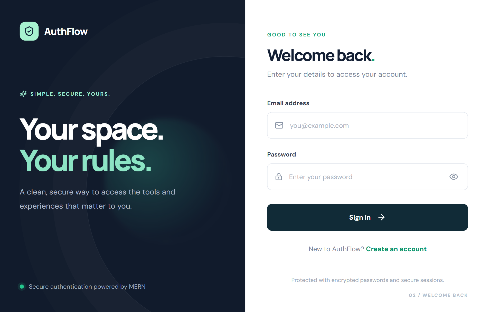
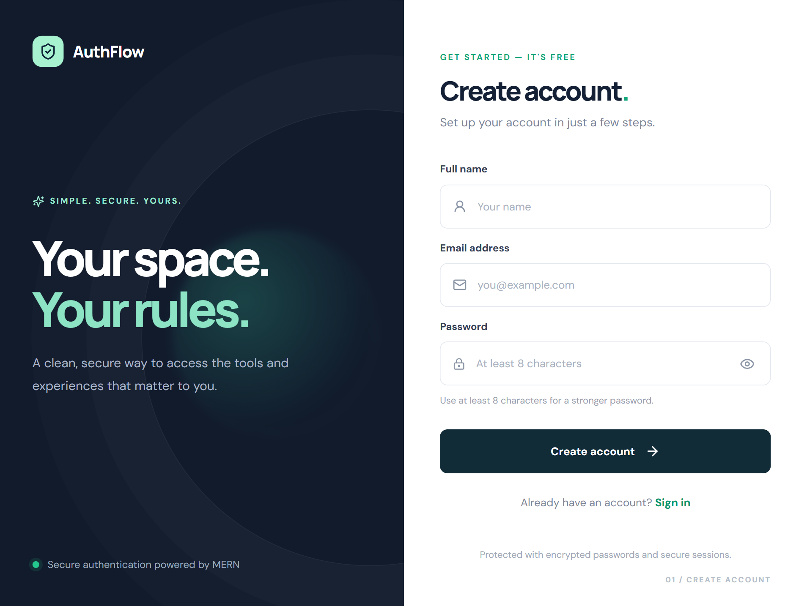
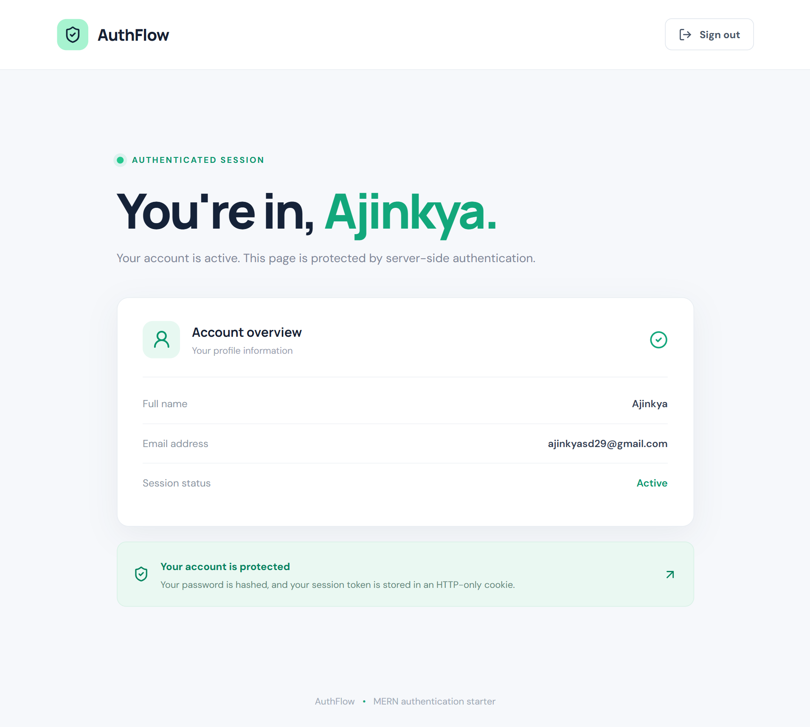

# 🔐 MERN Authentication System

<!-- Technology Badges -->


A full-stack authentication application built using the **MERN stack (MongoDB, Express.js, React.js, and Node.js)**. It provides secure user registration, login, logout, and protected dashboard functionality using JWT authentication and HTTP-only cookies.

---

## 📸 Screenshots

### Login Page


### Signup Page


### Dashboard


---

## ✨ Features

- 🔐 User Registration and Login
- 🔑 Secure password hashing using bcrypt
- 🍪 JWT authentication with HTTP-only cookies
- 🛡️ Protected routes and dashboard
- 🚪 Secure Logout functionality
- 📧 Email validation
- 🔒 Password length validation
- ⚡ Authentication rate limiting
- 🚫 Duplicate email prevention
- 📱 Fully responsive user interface
- 🔄 Persistent authentication sessions
- 🗄️ MongoDB database integration

---

## 🛠️ Tech Stack

### Frontend
- React.js
- React Router DOM
- CSS3
- Lucide React
- Vite

### Backend
- Node.js
- Express.js
- MongoDB
- Mongoose
- JSON Web Token (JWT)
- bcryptjs
- Cookie Parser
- Express Rate Limit
- Helmet
- CORS

---

## 📁 Project Structure

```text
mern-authentication-system/
│
├── client/
│   ├── src/
│   │   ├── components/
│   │   │   ├── AuthLayout.jsx
│   │   │   └── ProtectedRoute.jsx
│   │   │
│   │   ├── context/
│   │   │   └── AuthContext.jsx
│   │   │
│   │   ├── pages/
│   │   │   ├── Login.jsx
│   │   │   ├── Signup.jsx
│   │   │   └── Dashboard.jsx
│   │   │
│   │   ├── App.jsx
│   │   ├── api.js
│   │   ├── main.jsx
│   │   └── styles.css
│   │
│   ├── index.html
│   ├── package.json
│   └── vite.config.js
│
├── server/
│   ├── middleware/
│   │   └── requireAuth.js
│   │
│   ├── models/
│   │   └── User.js
│   │
│   ├── routes/
│   │   └── auth.js
│   │
│   ├── .env.example
│   ├── package.json
│   └── server.js
│
└── README.md
```

---

## ⚙️ Installation & Setup

### Prerequisites

Make sure you have installed:

- Node.js (v20 or later)
- MongoDB (Local or MongoDB Atlas)
- npm

### 1. Clone the Repository

```bash
git clone https://github.com/your-username/mern-authentication-system.git
```

```bash
cd mern-authentication-system
```

### 2. Setup Backend

```bash
cd server
npm install
```

Create a `.env` file inside the `server` folder.

```env
PORT=5000
MONGO_URI=mongodb://127.0.0.1:27017/mern_auth
JWT_SECRET=your_secure_random_secret
JWT_EXPIRES_IN=1d
CLIENT_URL=http://localhost:5173
NODE_ENV=development
```

Update the MongoDB connection string and JWT secret according to your environment.

Start the backend:

```bash
npm run dev
```

Backend runs at:

```text
http://localhost:5000
```

### 3. Setup Frontend

Open another terminal:

```bash
cd client
npm install
```

Start the React development server:

```bash
npm run dev
```

Frontend runs at:

```text
http://localhost:5173
```

---

## 🔗 API Endpoints

Base URL: `http://localhost:5000/api`

| Method | Endpoint | Description |
|---|---|---|
| POST | `/auth/signup` | Register a new user |
| POST | `/auth/login` | Authenticate user |
| POST | `/auth/logout` | Logout user |
| GET | `/auth/me` | Get authenticated user |

### Signup Request

```json
{
  "name": "John Doe",
  "email": "john@example.com",
  "password": "password123"
}
```

### Login Request

```json
{
  "email": "john@example.com",
  "password": "password123"
}
```

---

## 🔐 Security Implementation

- Passwords are hashed using bcrypt before storing them in MongoDB.
- JWT tokens are stored in HTTP-only cookies.
- Protected API routes verify JWT tokens.
- Authentication endpoints use rate limiting.
- Helmet helps secure HTTP headers.
- CORS is configured to allow the frontend origin.
- Server-side validation protects signup and login endpoints.

---

## 🚀 Future Improvements

-Email Verification
-Forgot Password / Reset Password
-Google OAuth Authentication
-Refresh Token Implementation
-User Profile Management
-Two-Factor Authentication (2FA)

---

## 👨‍💻 Author

**Ajinkya Dhatrak**

GitHub: [@ajinkya029](https://github.com/ajinkya029)

---

⭐ If you find this project useful, consider giving it a star!